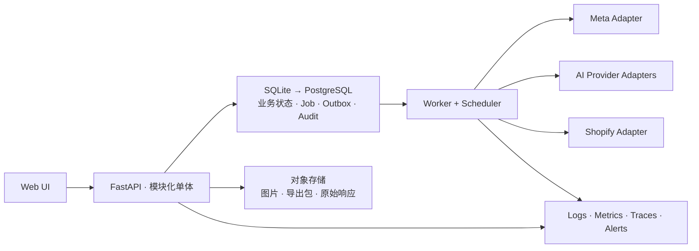

# MarketAI 后端架构（v2 · 生产级目标架构）

> 定稿日期：2026-08-24  
> 文档状态：**目标架构，尚未全部实现**  
> 适用范围：连接真实 AI Provider、Shopify 与 Meta 广告账户，涉及真实调用成本和广告预算的生产环境。  
> 产品决策见 `MarketAI产品蓝图.md`；Meta 字段口径见 `Meta广告数据完整参考.md`。若两者与本文冲突，
> 以本文的安全约束、数据不变量和上线门槛为准。

---

## 0. 结论与生产定义

当前代码是可用的单机原型，不是生产实现。v2 不要求一开始拆微服务，但必须具备以下生产能力：

1. **数据不丢、不互相覆盖。** 所有业务状态进入事务数据库；首版使用 SQLite，图片和原始响应进入对象存储。
2. **任务可恢复。** 进程、机器或网络中断后可以从持久化状态继续，不重复付费，不把半成品当成功。
3. **外部副作用可对账。** Meta 创建广告、AI 生图、Shopify 取数都不能依赖“请求刚好只执行一次”。
4. **真钱动作可审批、可追责。** 默认 PAUSED、预算硬上限、二次确认、审计日志和紧急停止缺一不可。
5. **实验结论可解释。** 不覆盖历史，不用不稳定标签做主键，不把相关性包装成因果结论。
6. **能被运维。** 有健康检查、指标、告警、备份、恢复演练、版本升级策略与明确 SLO。

首个生产版本可以是**单租户、单操作者**，但只要通过网络访问，就必须认证。数据表从第一天保留
`workspace_id`，避免未来接客户账户时做破坏性重构。

### 0.1 保留的产品决策

- 质量审核 `quality` 与投放结论 `verdict` 分离。
- Combo → Asset → AssetVersion → Ad 是 1:N 链。
- Meta 广告全部以 PAUSED 创建；系统不自动开启、调预算或关停。
- Winner 算法先产出建议，必须由人确认。
- 实验创建时快照盈亏线、营销变量和归因口径。
- 先保存原始数据，再生成可重算的派生指标。
- `judge` 保持纯函数：无数据库、网络、时钟和随机副作用。

### 0.2 推翻的 v1 决策

- JSON 文件不再是业务事实源；SQLite 是首个持久化 adapter，将来切 PostgreSQL 不改模块接口。
- `asyncio.create_task` 不再承担生产后台任务。
- `{asset_id: verdict}` 不再保存投放历史。
- Meta 实体名称不再充当幂等键。
- 单个全局 `schemas.py` 不再作为所有模块的唯一契约。
- “数据量超过 5 万行才上数据库”不再成立；是否需要事务与审计才是判断标准。

---

## 1. 总体架构：模块化单体 + 持久化 Worker



### 1.1 部署进程

| 进程 | 责任 | 不允许做的事 |
|---|---|---|
| API | 认证、参数校验、权限、创建命令、查询结果 | 不在请求内执行长时间生图、Meta 全量同步或本地化 |
| Worker | 领取持久化任务、调用外部 adapter、保存步骤结果 | 不绕过业务模块直接改最终判定 |
| Scheduler | 创建周期同步、重对账、归因回补、清理任务 | 不把内存定时器当唯一调度来源 |
| SQL 数据库 | 首版 SQLite；保存业务事实、事务、Job、Outbox、审计 | 不保存大图片或大体积原始响应 |
| 对象存储 | 图片、manifest、Meta 原始页、QC 附件 | 不保存唯一一份业务状态 |

Redis 可用于缓存、限流和任务唤醒，但不是业务事实源。Worker 必须只依赖 SQL 数据库就能恢复任务。
SQLite 阶段限定单机、单 API 实例和单 Worker 进程；不放在 NFS/网盘目录。需要多实例或高可用时切换
PostgreSQL adapter，模块接口和领域模型不变。

### 1.2 代码目录

```
app/
├─ api/                         # HTTP adapter：路由、认证、请求/响应 DTO
│  ├─ products.py
│  ├─ assets.py
│  ├─ generations.py
│  ├─ experiments.py
│  ├─ meta.py
│  └─ localization.py
├─ modules/
│  ├─ catalog/                  # 产品、维度、计划、素材、版本、质量审核
│  ├─ generation/               # 生成指纹、成本预留、任务编排、QC
│  ├─ experiments/              # 实验设计、参战条目、状态机
│  ├─ meta_integration/         # launch Saga、insights ingestion、reconcile
│  ├─ decision/                 # judge 纯函数、确认判定、Pattern 投影
│  └─ localization/             # 真值包、本地化任务、文字 QC
├─ adapters/
│  ├─ persistence/              # SQLAlchemy repositories / Unit of Work
│  │  ├─ sqlite.py              # 首个生产 adapter
│  │  └─ postgres.py            # 后续 adapter，不改变模块接口
│  ├─ object_store/             # S3/兼容实现 + 测试内存 adapter
│  ├─ ai/                       # Gemini / OpenAI / Seedream
│  ├─ meta/                     # Graph API
│  └─ shopify/                  # Shopify + 手动价格表
├─ platform/
│  ├─ auth.py
│  ├─ jobs.py
│  ├─ outbox.py
│  ├─ observability.py
│  └─ settings.py
└─ main.py                      # 组装 modules 与 adapters，不放业务逻辑

worker/
└─ main.py

migrations/                     # Alembic
tests/
├─ unit/
├─ integration/
├─ contract/
├─ recovery/
└─ e2e/
```

每个模块拥有自己的模型和接口。跨模块只传稳定 ID、命令和结果，不把数据库 ORM 对象或第三方响应结构
暴露给调用方。

---

## 2. 模块、接口与接缝

模块要深：调用方学习少量接口，重试、幂等、事务和状态转换都藏在实现内。

### 2.1 Catalog

负责产品、维度、计划、素材、版本及质量审核。

```python
create_product(command) -> ProductId
create_plan(command) -> PlanId
review_asset(command, expected_revision) -> QualityReview
create_asset_version(command) -> AssetVersionId
get_asset_history(asset_id) -> AssetHistory
```

不变量：

- Product、Dimension、DimensionValue 使用不可复用 UUID。
- 展示标签可以修改；统计归因只用稳定 ID。
- Plan 创建后不可原地修改；修改维度后必须生成新 Plan。
- AssetVersion 不覆盖原文件，必须记录父版本、内容哈希、生成参数、真值包 ID 与 QC 结果。
- 质量审核是追加记录；“当前质量状态”是最新记录的投影。

### 2.2 Generation

```python
plan_generation(command) -> GenerationPreview
start_generation(command, idempotency_key) -> RunId
cancel_generation(run_id, actor) -> CancelResult
retry_asset(asset_id, mode, actor) -> RunItemId
resume_generation(run_id, actor) -> ResumeResult
```

接口隐藏成本预留、任务拆分、重试、QC、对象存储提交与断点恢复。AI Provider 位于外部接缝：
生产使用 HTTP adapter，测试使用可编程的内存 adapter。

### 2.3 Experiments

```python
draft_experiment(command) -> ExperimentId
validate_experiment(experiment_id) -> ValidationReport
freeze_experiment(experiment_id, expected_revision) -> FrozenExperiment
get_battle_view(experiment_id) -> BattleView
close_experiment(command, expected_revision) -> CloseResult
```

`freeze_experiment` 后，参战条目、版本、营销变量、预算、盈亏线、账户币种、时区、归因窗口与统计计划
全部不可修改。需要修改时复制成新实验。

### 2.4 MetaIntegration

```python
preview_launch(experiment_id) -> LaunchPreview
request_launch(command, idempotency_key) -> LaunchOperationId
sync_insights(command, idempotency_key) -> IngestionId
reconcile_account(ad_account_id) -> ReconciliationReport
request_pause(command, idempotency_key) -> MetaOperationId
```

Meta 是真实外部依赖。模块拥有业务逻辑，Graph API 只是 adapter；上层不能直接调用 Graph API。

### 2.5 Decision

```python
judge(snapshot: JudgementSnapshot) -> SuggestionReport
confirm_decision(command, expected_revision) -> DecisionBatchId
project_patterns(workspace_id, as_of) -> PatternProjection
```

`judge` 是纯函数。数据库读取、快照构造、人工确认与落库在模块实现的其他部分完成。

### 2.6 Localization

```python
build_truth_package(command) -> TruthPackageId
preview_localization(command) -> LocalizationPreview
start_localization(command, idempotency_key) -> LocalizationBatchId
retry_localization_item(item_id, actor) -> LocalizationItemId
```

Shopify 与手动价格表是两个真实 adapter，因此数据源接缝是必要的。真值包失败或降级属于显式领域状态，
不能用空字符串默默代替。

---

## 3. 领域模型与关键不变量

### 3.1 对象链

```
Product
  └─ DimensionSchemaVersion
      └─ Plan
          └─ PlanEntry / Combo
              └─ GenerationRunItem
                  └─ Asset
                      └─ AssetVersion
                          └─ ExperimentEntry
                              └─ AdBinding
                                  └─ AdDailyMetric
```

`combo_code` 和中文标签只用于展示。Pattern、对账和历史关联使用：

```
combo_fingerprint = sha256(
  canonical_json(sorted([{dimension_id, value_id}, ...]))
)
```

生成防重指纹至少包含：

```
product_snapshot_hash
combo_fingerprint
prompt_template_version
rendered_prompt_hash
provider
model
aspect_ratio
image_size
reference_image_hashes
seed_or_variation_policy
```

### 3.2 双状态改为“历史 + 投影”

质量历史：

```
quality_reviews(
  id, workspace_id, asset_id, quality,
  reason, source, actor_id, created_at
)
```

投放历史：

```
decision_batches(id, experiment_id, suggestion_snapshot_id, actor_id, created_at)
experiment_entry_results(
  id, decision_batch_id, experiment_entry_id,
  verdict, evidence_json, context_snapshot_json, created_at
)
```

严禁再用 `{asset_id: verdict}`。同一 Asset 在 US/LP-A 可以 win，在 KR/LP-B 可以 learn，两条历史都必须
保留。素材卡显示的 verdict 是按当前筛选环境计算的投影，不是素材的全局属性。

### 3.3 Experiment 状态机

```
draft → frozen → launching → launched → live → eligible_for_judgement
  └──────────────────────────────────────────────→ cancelled
eligible_for_judgement → awaiting_confirmation → closed
```

规则：

- `draft` 可编辑。
- `frozen` 之后只能取消或复制，不能修改实验输入。
- `launched` 表示 PAUSED 实体和映射全部创建完成，不代表开始花费。
- 每条 ExperimentEntry 独立记录 `first_active_at`、`first_spend_date`、拒审和暂停区间。
- 实验级 `live` 是投影视图；Day-N 资格按每条广告的完整投放天数计算。
- `closed` 只能由确认判定命令进入，且保存完整证据快照。

### 3.4 Job 状态机

```
queued → leased → running → succeeded
                    ├─ retry_wait → queued
                    ├─ failed
                    └─ cancelling → cancelled
```

每个 Job 保存：

- `id`、`type`、`payload_version`、`payload_json`
- `idempotency_key`、`attempt`、`max_attempts`
- `lease_owner`、`lease_expires_at`、`heartbeat_at`
- `next_attempt_at`、结构化错误码、可重试标记
- `created_at`、`started_at`、`finished_at`

Worker 通过 Job repository 原子领取任务；SQLite 用短事务条件更新，PostgreSQL adapter 可使用行锁。
租约过期后其他 Worker 可接管。取消只阻止未开始步骤，已发出的外部调用
必须等待结果并对账，不能假装调用已撤销。

---

## 4. 持久化设计

### 4.1 SQL 数据库是唯一业务事实源

首版使用 SQLite + SQLAlchemy 2.x + Alembic：

- 数据库默认位于 `data/marketai.db`，必须是本机持久磁盘。
- 连接启用 `foreign_keys=ON`、`journal_mode=WAL`、`synchronous=FULL`、`busy_timeout`。
- Alembic 使用 SQLite batch migration；迁移在应用启动前显式执行，不在请求处理中自动建表。
- 领域模块只依赖 repository / Unit of Work 接口，不包含 SQLite 方言 SQL。
- 类型只使用 SQLite/PostgreSQL 都能表达的 UUID 字符串、UTC 时间、JSON、NUMERIC、整数和文本。
- 金额与哈希一致性由应用和数据库约束共同保证。

切 PostgreSQL 的触发条件满足任一即可：需要多个 API/Worker 实例；持续写锁等待影响 SLO；需要跨机器高可用；
备份与恢复目标无法由单机 SQLite 满足。切换时新增 PostgreSQL adapter、迁移数据并切连接串，不重写模块。

最低表集合：

| 领域 | 表 |
|---|---|
| 身份与隔离 | `workspaces`、`users`、`memberships` |
| 产品资产 | `products`、`dimension_schema_versions`、`dimensions`、`dimension_values` |
| 计划生成 | `plans`、`plan_entries`、`generation_runs`、`generation_run_items` |
| 素材 | `assets`、`asset_versions`、`quality_reviews`、`qc_attempts` |
| 实验 | `experiments`、`experiment_entries`、`experiment_status_events` |
| Meta | `meta_accounts`、`launch_operations`、`launch_steps`、`ad_bindings` |
| 数据摄取 | `insight_ingestions`、`insight_pages`、`ad_daily_metrics`、`entity_status_events` |
| 判定 | `suggestion_snapshots`、`decision_batches`、`experiment_entry_results` |
| 本地化 | `data_sources`、`truth_packages`、`localization_batches`、`localization_items` |
| 平台 | `jobs`、`outbox_events`、`audit_events`、`cost_ledger`、`idempotency_keys` |

所有业务表包含 `workspace_id`、UTC `created_at`；可修改聚合根包含 `revision` 做乐观并发控制。
外键、唯一约束和 CHECK 约束在数据库落地，不只依赖 Pydantic。

### 4.2 金额与时间

- 金额使用 `NUMERIC` 或整数最小货币单位，禁止二进制 float。
- 每条金额同时保存 ISO 4217 `currency`。
- 广告预算和花费以广告账户币种为准；UI 显示美元只是格式选择，不是数据假设。
- 所有时间戳以 UTC 保存；广告按账户 `timezone_name` 划分日期。
- `date_start/date_stop` 保存 Meta 原值，不能用服务器所在时区重新切日。

### 4.3 对象存储

```
workspaces/{workspace_id}/
├─ products/{product_id}/refs/{sha256}.{ext}
├─ assets/{asset_id}/versions/{version_id}/{sha256}.{ext}
├─ meta/raw/{account_id}/{ingestion_id}/{page_no}-{sha256}.json.gz
├─ localization/{batch_id}/{item_id}/{sha256}.{ext}
└─ exports/{export_id}/{sha256}.zip
```

对象上传流程：

1. 上传临时对象。
2. 校验类型、大小、像素、内容哈希。
3. 数据库事务写 AssetVersion 与对象键。
4. 提交后标记正式对象；后台清理无引用临时对象。

数据库保存对象键、哈希、大小、MIME、宽高，不保存本地绝对路径。

### 4.4 事务、Outbox 与幂等

- 一个数据库内的状态变化必须在同一短事务完成；SQLite 事务内禁止网络调用和大文件处理。
- 事务内同时写 `outbox_events`；Worker 提交事务后投递副作用。
- 所有可能产生费用或远端实体的 POST 接受 `Idempotency-Key`。
- 相同 key + 相同请求返回第一次结果；相同 key + 不同请求返回 409。
- 幂等记录至少保留到外部系统的最大重试窗口之后。

---

## 5. 生成、QC 与成本控制

### 5.1 开始生成

1. API 调用 `plan_generation`，返回任务数、逐项成本估算、总成本、可复用数量和缺失配置。
2. 用户确认后调用 `start_generation`。
3. 同一事务内：
   - 校验 `expected_revision`；
   - 预留本次成本；
   - 创建 GenerationRun 与每个 RunItem；
   - 创建 Job 与审计事件。
4. Worker 按 Provider/账户限流领取 RunItem。
5. 图片先写对象存储临时区，校验成功后再把 RunItem 标为 `generated`。
6. 有 QC 时进入 `qc_pending`；QC 通过才产生可审核 AssetVersion。

### 5.2 成本账本

`cost_ledger` 使用追加分录：

- `reserved`：任务创建时预留。
- `committed`：Provider 已接受且按合同可能计费。
- `actual`：响应含真实 usage 时记录。
- `released`：未执行、取消或复用时释放。
- `adjustment`：人工对账差异。

硬约束：

- `MAX_COST_PER_RUN`、`MAX_COST_PER_DAY`、`MAX_COST_PER_WORKSPACE` 在数据库事务内检查。
- `confirm_cost=true` 不能绕过 workspace 硬上限。
- 重试是否产生额外费用必须进入 Preview 和 Ledger。
- 达到硬上限时 Worker 停止领取新付费步骤并告警。

### 5.3 重试与取消

- 只重试明确可恢复错误：超时、连接中断、429、部分 5xx。
- 400、认证、权限、内容政策和确定性输入错误直接失败。
- 尊重 `Retry-After`；指数退避加抖动；按 Provider 设置并发和熔断。
- 错误分类基于状态码和结构化响应，不通过错误字符串包含关系判断。
- 保存 Provider request ID，日志和用户响应中必须脱敏。
- 已在外部执行中的调用不能真正取消；返回后记录结果，再决定保留或隔离。

### 5.4 QC

自动 QC 保存每次 Attempt：

```
qc_attempts(
  asset_version_id, attempt_no, model, checklist_version,
  reference_hashes, result, errors_json, raw_object_key, created_at
)
```

`must_match` 同时进入 prompt 和 QC 清单，但清单要版本化。三次失败后自动建议 `rejected`，仍保留
生成结果和原因；自动 QC 不可静默覆盖人工质量审核。

---

## 6. Meta 集成

### 6.1 MetaClient adapter

统一处理：

- Graph API 版本、base URL、认证、App Secret Proof。
- connect/read timeout、连接池、分页与游标。
- Usage 响应头、Insights throttle、429/5xx 退避。
- Meta error code/subcode 到结构化错误的映射。
- request ID、响应摘要和脱敏日志。

版本策略：

- `META_API_VERSION` 必须显式配置，不使用“永远默认某版本”。
- 每次 ingestion 和 launch 记录实际 API 版本。
- 升级前跑 contract fixtures、只读真实账户探针和 PAUSED canary。
- 版本临近停止支持前 60 天告警。

Token 存密钥管理系统；本地开发才允许 `.env`。Token 不进入 URL 日志、数据库、前端或错误响应。

### 6.2 Launch Saga

远端 Meta 与本地数据库无法使用同一个事务，因此创建广告必须是可恢复 Saga：

```
planned
  → campaign_created
  → adsets_created
  → images_uploaded
  → creatives_created
  → ads_created
  → bindings_verified
  → completed
```

`launch_steps` 逐步保存：

- 本地稳定 step key。
- 请求规范化哈希。
- remote object type/id。
- Meta request ID。
- attempt、状态、错误、时间。

每次远端成功后立即提交该步骤，再执行下一步。重跑时从最后一个已验证步骤继续。名称只用于人读和辅助
对账，不是幂等保证。若本地提交失败但远端成功，`reconcile_account` 必须能用 launch marker、命名和
UTM 找回并绑定孤儿实体。

所有 Campaign、AdSet、Ad 创建参数都显式写 `PAUSED`。Launch Preview 展示结构、账户币种预算、
落地页、Pixel、Page、营销变量和预计最大成本。正式 Launch 需要二次确认 token，短时有效且绑定
Preview 哈希；Preview 变化后旧确认失效。

### 6.3 AdBinding

```
ad_bindings(
  workspace_id,
  experiment_entry_id,
  ad_account_id,
  campaign_id,
  adset_id,
  creative_id,
  ad_id,
  launch_operation_id,
  mapping_version,
  created_at,
  retired_at
)
```

`ad_id` 全局唯一。绑定包含稳定的 ExperimentEntry、AssetVersion 和营销变量快照；不得只保存
`combo_code` 或可修改标签。

### 6.4 Insights ingestion

每次同步先创建 `insight_ingestions`，记录：

- account_id、account_currency、account_timezone。
- API 版本、fields、level、filtering、breakdowns。
- `time_range`、`time_increment`、`action_report_time`。
- `action_attribution_windows`、返回的 `attribution_setting`。
- started_at、completed_at、页数、行数、状态。

当前决策契约固定为 `schema_version=2`、`7d_click + 1d_view`；任一语义字段变化必须生成新的
`contract_hash` 并先完成独立同步 canary，禁止覆盖历史契约或混用不同契约的指标。

每拉完一页立即：

1. 将原始响应压缩写对象存储；
2. 保存 page_no、cursor、对象键和 sha256；
3. 再继续下一页。

全部页完成后才解析并 upsert `ad_daily_metrics`。中断时可以从已保存 cursor 继续；解析器升级时可以
从原始页重放。

同步计划：

- 每日同步最近的“配置归因窗口 + 安全缓冲”。
- 每周做更长窗口重对账，修复迟到转化、删除实体和历史口径变化。
- 今天的数据标记 `partial`，Decision 默认不使用。
- 同步新鲜度超过 SLO 时禁止给出最终 Winner 建议。

### 6.5 指标语义

- 购买事件类型成为实验快照字段，默认值可为 `omni_purchase`，但不能写死在解析器。
- 精确匹配 action_type；缺席事件按 0 处理。
- 原始字符串解析为 Decimal/整数。
- Reach 不跨日相加，Frequency 不做日均值。
- 所有判定保存账户币种、时区、归因口径与数据截止时间。
- Pixel/CAPI 事件质量属于 Launch 前置检查；数据异常时实验状态为 `data_quality_blocked`。

### 6.6 Reconcile

自动对账至少覆盖：

- Meta 有实体、本地无绑定。
- 本地有绑定、Meta 实体不存在或被删除。
- 名称/UTM marker 与绑定不一致。
- 实际状态、预算、落地页与冻结实验不一致。
- Insights 中出现未知 ad_id。
- 已关闭实验仍在持续花费。

高风险差异立即告警。系统默认只建议处理；任何暂停动作仍需明确授权并写审计。

---

## 7. Winner 与 Pattern

### 7.1 JudgementSnapshot

`judge` 的唯一输入是不可变快照：

```python
class JudgementSnapshot:
    experiment: FrozenExperiment
    entries: list[FrozenExperimentEntry]
    daily_metrics: list[DailyMetric]
    status_intervals: list[StatusInterval]
    data_quality: DataQualityReport
    as_of: datetime
    algorithm_version: str
```

同样的快照和算法版本必须产生字节级等价结果。

### 7.2 资格门槛

每条广告独立计算：

- 完整投放天数，不使用实验统一 started_at 代替。
- 有效花费、展示、点击、购买和数据成熟度。
- 拒审、学习受限、暂停、数据缺失区间。
- 归因窗口是否已经成熟。

数据不完整、同步过期、事件质量异常或实验输入漂移时，结果只能是 `inconclusive`，不能降级为
`learn` 后继续假装数据可信。

### 7.3 统计规则

- CTR/CVR 等二项比例可以使用 Wilson 区间。
- CPA/ROAS 是偏态连续指标，使用 bootstrap、贝叶斯后验或明确的业务阈值，不使用 Wilson。
- 8–15 个创意同时比较时处理多重比较，或使用层级模型进行收缩。
- 早停规则在实验冻结时确定；运行中看过结果后不得临时修改阈值。
- Stop-loss 可以作为预算保护，但被早停样本不得与完整样本等价解释。
- “最优但未过盈亏线 → 全轮无 Winner”继续保留。
- “购买不足 → 不强选 Winner”继续保留。

### 7.4 Pattern 资格

两轮同方向不自动等于因果 Pattern。升级必须满足：

1. 变量使用相同稳定 DimensionValue ID 或明确的语义版本映射。
2. 两轮都把该变量声明为被测变量。
3. 其他关键变量受控、均衡或进入模型校正。
4. 方向一致且证据达到预先设定的最低可信度。
5. 不跨不兼容市场、Offer、LP、版位和归因口径直接合并。
6. 记录算法版本、样本量、效应区间与适用上下文。

Pattern 是可重建投影；确认的实验结果和证据快照是不可变事实。

### 7.5 盈亏线

ProductEconomics 至少包含：

```
price
discount
cogs
payment_fee
fulfilment_cost
shipping_subsidy
expected_refund_rate
target_contribution_margin
currency
effective_from
```

系统计算 `target_cpa` 与 `breakeven_roas`，允许人工覆盖但必须记录原因。实验冻结时保存完整经济模型
快照，不能只存两个最终数字。

---

## 8. 本地化与真值包

产品手册承诺的本地化属于正式后端范围，不能只留在前端 mock。

TruthPackage 是不可变快照，至少保存：

- product_id、source adapter、source revision。
- 市场、货币、主价、划线价、折扣、组件价、运费与可配送状态。
- 每个事实的来源、获取时间、有效期和置信状态。
- `complete | degraded | failed`。
- 原始响应对象键和内容哈希。

规则：

- 价格表保存后创建新 revision，不删除旧真值包。
- 每个 LocalizationBatch 固定引用一个 TruthPackage。
- 降级包缺失的事实只能“保留原声明”或阻止任务，不允许生成数字。
- 翻译、图像编辑、文字 QC 分成独立 RunItem；每一步可恢复、可重试、可审计。
- 输出文件存在不是任务完成的唯一依据；必须同时有数据库状态和内容哈希。

---

## 9. HTTP 接口

### 9.1 通用规则

- 所有写请求需要认证、workspace 授权和 CSRF 防护（使用 Cookie 时）。
- 所有昂贵或有外部副作用的 POST 需要 `Idempotency-Key`。
- 可修改资源使用 `revision` / `If-Match`，冲突返回 409。
- 错误响应返回稳定 error code、request_id 和可操作提示，不返回密钥或第三方完整响应。
- 列表接口分页；导出走异步任务和对象存储签名下载，不把整个 ZIP 放入 API 内存。

### 9.2 核心路由

| 路由 | 说明 |
|---|---|
| `POST /api/products` | 新建产品 |
| `POST /api/products/{pid}/plans` | 创建不可变 Plan |
| `POST /api/generations/preview` | 成本与复用预览 |
| `POST /api/generations` | 创建持久化生成任务 |
| `POST /api/generations/{id}/cancel` | 请求取消 |
| `POST /api/assets/{id}/quality-reviews` | 追加人工质量审核 |
| `POST /api/assets/{id}/versions` | 创建版本 |
| `POST /api/experiments` | 新建实验草稿 |
| `POST /api/experiments/{id}/freeze` | 冻结实验输入 |
| `POST /api/experiments/{id}/launch-preview` | 生成 Launch Preview |
| `POST /api/experiments/{id}/launch` | 创建 PAUSED 广告的 Saga |
| `POST /api/meta/ingestions` | 创建只读同步任务 |
| `POST /api/meta/reconciliations` | 创建对账任务 |
| `GET /api/experiments/{id}/battle` | 战况投影 |
| `GET /api/experiments/{id}/suggestion` | 读取建议和证据 |
| `POST /api/experiments/{id}/decisions` | 人工确认并追加结果 |
| `POST /api/localizations/preview` | 本地化预览 |
| `POST /api/localizations` | 创建本地化任务 |

删除公开的 `POST /assets/{id}/verdict`。任何投放结论必须关联 ExperimentEntry、SuggestionSnapshot、
操作者和确认时间。

---

## 10. 安全与审计

### 10.1 身份与权限

最低角色：

- `viewer`：只读。
- `operator`：生成、同步、质量审核、创建实验。
- `approver`：确认预算、Launch 和最终判定。
- `admin`：密钥、账户映射与权限管理。

单人环境可由同一用户拥有 operator/approver，但系统仍保存审批动作。接客户后支持职责分离。

### 10.2 密钥

- 生产密钥进入云密钥管理或等价系统，数据库只保存 secret reference。
- 密钥按 workspace/ad account 隔离，支持轮换和吊销。
- 日志、Trace、异常、任务 payload 和审计事件统一脱敏。
- Meta 服务端调用启用 App Secret Proof。
- `/status` 只返回配置状态、权限探针结果和过期时间，不返回 token。

### 10.3 输入与文件

- 上传限制：文件数、总字节、单文件字节、像素、尺寸、MIME 白名单。
- 防止图片解压炸弹；解码在受限 Worker 中执行。
- 所有对象键由服务端生成；用户输入不得直接拼接本地路径或对象键。
- URL 抓取使用 SSRF 防护、域名策略、超时和最大响应限制。
- Prompt、图片、Meta 原始响应和导出包定义保留期与删除流程。

### 10.4 审计

`audit_events` 追加不可改，至少记录：

- actor、workspace、request_id、IP/客户端。
- action、resource type/id。
- before/after 摘要或 revision。
- Preview 哈希、预算、Meta remote IDs。
- 成功/失败、错误码、时间。

Launch、暂停、判定确认、密钥变更、价格表修改和成本上限覆盖必须产生审计事件。

---

## 11. 可观测性、SLO 与灾备

### 11.1 指标

业务与系统指标至少包括：

- Job queue lag、运行时长、重试率、永久失败率、lease 回收次数、SQLite busy/锁等待时间。
- 各 Provider 成功率、429、p95 延迟、估算/真实成本。
- Meta usage、同步新鲜度、分页失败、未知 ad_id、对账差异。
- Launch Saga 各步骤失败和悬挂时长。
- 每 workspace 每日生成成本和广告预算。
- 数据库连接、事务冲突、对象上传失败。

### 11.2 告警

立即告警：

- 已关闭实验仍产生花费。
- Launch 出现远端孤儿实体。
- 成本或预算超过硬上限。
- Meta 同步超过新鲜度 SLO。
- 数据质量阻止判定。
- Job 在同一步重复失败或悬挂。

### 11.3 首版 SLO

| 项目 | 目标 |
|---|---|
| API 可用性 | 月度 99.9% |
| 普通读请求 | p95 < 500ms |
| 写命令入队 | p95 < 1s |
| 每日 Meta 数据新鲜度 | 计划时间后 2 小时内 |
| 已接收 Job 不丢失 | 100% |
| 恢复目标 RPO | ≤ 15 分钟 |
| 恢复目标 RTO | ≤ 2 小时 |

### 11.4 备份

- SQLite 阶段使用在线 Backup API/`VACUUM INTO` 生成一致备份并异地保存；切 PostgreSQL 后启用自动备份 + PITR。
- 对象存储版本控制和生命周期策略。
- 至少每季度做一次恢复演练；“存在备份”不等于“能够恢复”。
- 恢复后运行引用完整性、对象哈希和 Meta 对账检查。

---

## 12. 测试策略

### 12.1 单元测试

- `judge` 全规则、边界、属性测试和算法快照测试。
- 组合指纹、成本计算、状态机非法迁移。
- Insights 字符串数值、缺席 0、精确 action_type、时区与币种。

### 12.2 集成测试

- SQLite 真实文件库：事务、唯一约束、乐观锁、Outbox、WAL 恢复和 busy retry。
- PostgreSQL adapter 落地后，对同一 repository contract 跑完全相同的测试套件。
- 对象存储 adapter：临时对象提交与孤儿清理。
- Worker：lease 过期、进程退出、任务接管和取消。

### 12.3 Contract 测试

- AI Provider、Meta、Shopify 使用脱敏固定响应夹具。
- 每次外部 API 版本升级先跑 contract。
- 外部错误分类、Retry-After、分页、token 过期与权限不足。

### 12.4 Recovery 与故障注入

必须覆盖：

- 图片上传成功、数据库提交前进程退出。
- Meta 创建 Ad 成功、本地提交前进程退出。
- Insights 第 N 页成功后网络中断。
- Worker lease 中途过期。
- 同一 Idempotency-Key 并发提交。
- 两个操作者同时确认同一实验。
- 数据库恢复后重新对账。

### 12.5 E2E

1. Mock 全闭环。
2. Meta 只读真实账户。
3. 专用测试账户创建一条最小 PAUSED 广告。
4. 人工核对后删除/归档测试实体并验证对账。
5. 一轮真实小预算 canary，完整关闭并重放判定。

CI 不能依赖个人真实广告账户，也不能自动开启广告。

---

## 13. 从当前代码迁移

施工顺序以“不变量先行”为准：

| 顺序 | 阶段 | 交付范围 |
|---|---|---|
| 0 | 双状态 + 营销变量 | 已完成；语义保留，存储升级为历史 + 投影 |
| 1 | 底座 + 生产 | SQLite/Alembic、JSON 导入、持久化 Worker、成本账本、硬上限、防重指纹、AssetVersion、Decimal + 币种 |
| 2 | Meta 只读 | MetaClient、逐页原始归档、断点续拉、daily、状态历史、对账；完成后立即启动 14 天观察 |
| 3 | 实验与判定 | 冻结快照、纯函数 judge、inconclusive、追加式判定 |
| 4 | Launch canary | Preview、二次确认、Saga、最小 PAUSED 广告、故障注入 |
| 5 | 真实一轮 | Gate 3：frozen → closed 完整闭环 |
| 6 | 扩展 | 本地化真值包、KOL |

阶段 2 的 14 天观察期与阶段 3、4 的开发并行计时；不能为了等待观察期停止后续只涉及本地代码的工作。

当前实施状态（2026-08-25）：真实账户的 `schema_version=2 / 7d_click + 1d_view` contract canary
已同步并对账通过，常驻 Worker 已启用。观察时钟同时绑定 `observation_contract_hash`；契约变化时必须由
新契约的首个成功同步重置 `observation_started_at`，不同契约的运行时长不得累计到同一个 Gate。

阶段 3 的代码实施也已完成：Experiment/Entry 在冻结时保存内容哈希与营销变量快照；`judge-v1` 是无 I/O 纯函数，CTR 使用 Wilson 区间，CPA/ROAS 使用固定种子的 bootstrap；输入快照、结果和逐 Entry 决策全部追加保存。旧的直接 verdict HTTP 写入口已禁用，画廊判定投影以最新 ExperimentDecision 为准。真实数据统计校准仍需与阶段 2 的观察结果一起验收。

阶段 4 的安全框架已实现：写 Token 与只读 Token 隔离且 kill switch 默认关闭；Preview、确认 token、Operation、Step 和审计均持久化；Campaign/AdSet/Ad 请求与远端回读都断言 `PAUSED`；稳定 marker 支持“远端成功、本地提交前崩溃”后的找回。Fake Meta adapter 已完成逐步故障注入。尚未配置或调用真实写接口，因此真实最小 PAUSED canary 仍是明确的人工 Gate，不能标记为完成。

### 阶段 A：建立生产底座

1. 引入 SQLite、SQLAlchemy、Alembic、Repository 与 Unit of Work；保持方言可迁移。
2. 落地稳定 ID、历史 + 投影、AssetVersion、Decimal + 币种、成本账本和防重指纹。
3. 为现有 Product、Angle、Plan、Run、Asset、Quality、Verdict 编写一次性 JSON 导入器。
4. 导入前保存源文件哈希；导入后输出计数、缺失引用和校验报告。
5. JSON 切为只读兼容源，验证后停止双写。
6. 建对象存储并迁移 refs、run 图片，数据库保存对象键和哈希。

完成标志：重复导入幂等；数量、哈希和引用全部一致；恢复演练通过。

### 阶段 B：任务系统

1. GenerationRun 拆成 Run + RunItem。
2. Worker 取代 `asyncio.create_task`。
3. 落地 cost ledger、重试、取消、resume 和 QC attempt。
4. 导出改异步任务。

完成标志：任意步骤 kill Worker 后自动恢复，不重复生成已成功素材，不突破成本上限。

### 阶段 C：Meta 只读

1. MetaClient adapter、密钥管理和权限探针。
2. 分页原始归档、解析器、daily metrics、状态历史。
3. Scheduler、数据新鲜度与 reconcile。

完成标志：连续运行 14 天；数据与 Ads Manager 在声明口径下可解释对齐；失败可重放。

### 阶段 D：实验与判定

1. 不可变 Experiment、Entry 和统计计划。
2. JudgementSnapshot、SuggestionSnapshot、DecisionBatch。
3. 移除直接 verdict 写入口。
4. Pattern 投影按稳定 ID 和适用上下文重建。

完成标志：历史不覆盖；同一快照可重现同一结论；并发确认只有一次成功。

### 阶段 E：Meta 写入 canary

1. Launch Preview、二次确认、Saga、Outbox 与审计。
2. 专用测试账户创建最小 PAUSED 广告。
3. 注入每一步失败并验证恢复和孤儿发现。
4. 配置 workspace 预算硬上限和 kill switch。

完成标志：所有失败点可安全重跑；对账无未解释差异；没有任何路径可自动开启广告。

### 阶段 F：本地化

1. TruthPackage 与数据源 revision。
2. 本地化持久化任务、翻译、编辑和文字 QC。
3. 完整/降级/失败三态与审计。

完成标志：价格来源可追溯；任务可恢复；缺失事实不会被模型编造。

---

## 14. 上线门槛

### Gate 1：只读生产

- 认证、审计、SQLite、对象存储、Worker、备份恢复完成。
- Meta 只读同步连续 14 天稳定。
- 无未解释的数据对账差异。
- 日志和错误响应通过密钥泄漏测试。

### Gate 2：写入 canary

- 只允许自有测试广告账户。
- 单次 Launch 有极低硬上限。
- Preview 与正式请求哈希一致。
- 只创建 PAUSED；紧急停止和对账已演练。
- Meta Saga 故障注入全部通过。

### Gate 3：真实小预算

- 一轮完整实验从 frozen 到 closed。
- 数据窗口成熟后才允许确认。
- 判定、证据、操作者和上下文可完整重放。
- 备份恢复后仍能重建战况与 Pattern。

未通过 Gate 3 前，不得对外称为 self-serve production，也不得接客户广告账户。

---

## 15. Non-goals

首版生产实现仍然不做：

- 自动开启广告、自动调预算、自动暂停或删除 Meta 实体。
- MMM、跨渠道复杂归因或用户级追踪。
- 微服务拆分、Kafka 或 Kubernetes，除非实际负载和组织结构证明需要。
- 自动把相关性结论宣传为因果规律。
- 跨客户聚合；在租户隔离、匿名化、授权和最小样本策略完成前禁止启用。
- Flexible Ads 微变体和 KOL 模块，待主闭环通过 Gate 3 后另行设计。

---

## 16. 架构决策摘要

| 决策 | 选择 | 原因 |
|---|---|---|
| 应用形态 | 模块化单体 + Worker | 保持部署简单，同时隔离长任务 |
| 业务存储 | SQLite-first，后续 PostgreSQL adapter | 首版部署简单，同时保留事务、约束、审计与迁移能力 |
| 大对象 | S3/兼容对象存储 | 图片与原始响应可校验、可扩展 |
| 任务事实源 | SQL Job + lease | 进程退出后可恢复；不绑定具体数据库方言 |
| 外部副作用 | Saga + Outbox + reconcile | 无法做跨系统原子事务 |
| 状态历史 | Append-only event/record + projection | 不覆盖实验和审核历史 |
| 判定 | 纯函数 + 不可变快照 | 可测试、可重放、可解释 |
| 外部集成 | 模块接口 + production/test adapters | 在接缝替换行为，不泄漏第三方细节 |
| Meta 写路径 | Preview + 二次确认 + PAUSED | 保护真实预算 |
| API 版本 | 显式配置 + contract/canary | 应对 Meta 版本演进 |

本文是后续后端实现的基线。任何违反数据不变量、绕过审批、把业务事实退回内存/JSON，或让外部写操作
失去幂等与对账能力的改动，都必须先更新本文并记录架构决策。
